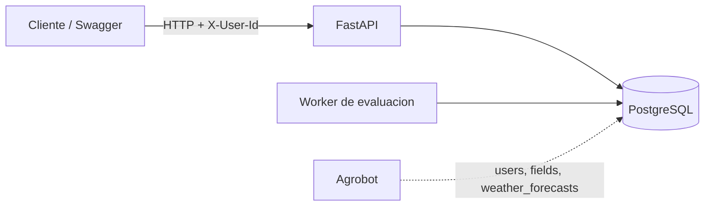
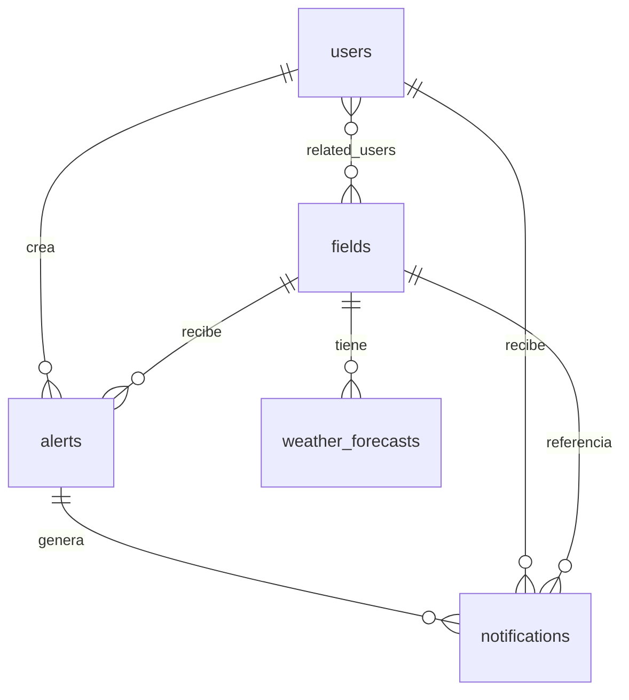
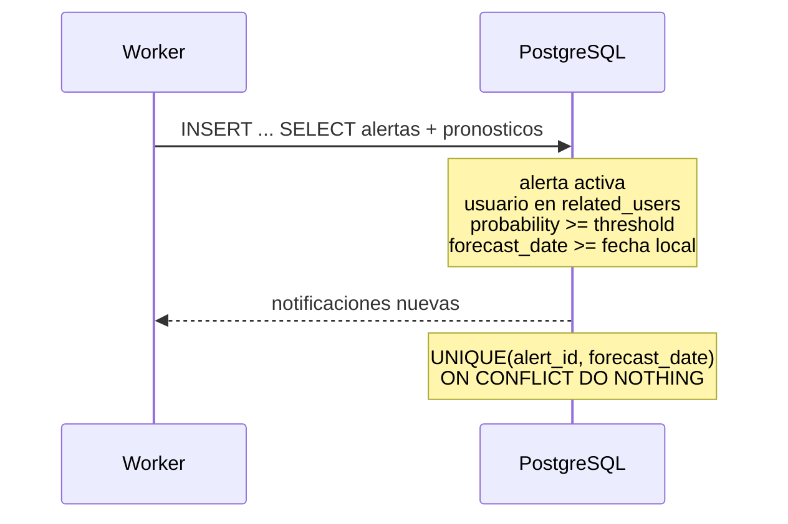

# Agroclimate - FieldData Challenge

[](https://github.com/gbaudino/prueba-fielddata/actions/workflows/pull-request.yml)

API de alertas climaticas. Consume usuarios, campos y pronosticos de Agrobot, y
administra alertas y notificaciones: el usuario define un umbral, el worker
evalua los pronosticos y la API expone las notificaciones generadas.

El codigo es la fuente de verdad. Las decisiones que no estan implementadas
quedan marcadas como limite o trabajo futuro.

## Stack

Python 3.14 · FastAPI · PostgreSQL · SQLAlchemy async · Alembic · structlog ·
Docker Compose · uv · pytest · Ruff · Mypy.

## Arquitectura



La API y el worker comparten la base. `users`, `fields` y `weather_forecasts`
son datos de Agrobot y este servicio solo los lee. `alerts` y `notifications`
son propias y se crean con Alembic.

## Modelo de datos



- Una alerta es unica por `(user_id, field_id, event_type)`.
- Una notificacion es unica por `(alert_id, forecast_date)`.
- Cada notificacion guarda el `probability` y el `threshold` del momento.
- Si se borra una alerta, sus notificaciones se conservan con `alert_id = NULL`.

## Prueba rapida para el revisor

Requisitos: Docker, Docker Compose y [uv](https://docs.astral.sh/uv/).

```bash
cp .env.example .env
uv sync --locked
make start
make demo
```

`make start` construye la imagen, levanta PostgreSQL, crea las tablas externas
locales, aplica las migraciones y levanta la API y el worker. Swagger queda en
`http://localhost:8000/docs`.

`make demo` carga los datos demo si faltan, busca un usuario/campo con
pronosticos suficientes, crea una alerta por la API, corre el worker, lista las
notificaciones y vuelve a correr el worker para mostrar que no se duplican. No
usa IDs fijos.

Si queres probar a mano, el seed crea 100 usuarios y 200 campos. Para obtener un
par valido:

```bash
docker compose exec db sh -c 'psql -U "$POSTGRES_USER" -d "$POSTGRES_DB"'
```

```sql
select u.id as user_id, f.id as field_id
from users u
join fields f on u.id = any(f.related_users)
limit 1;
```

Despues podes crear una alerta con `curl` usando esos IDs.

## API

Todas las rutas de negocio requieren `X-User-Id` con un UUID existente. Si falta
o es invalido responde `401`/`422`; si el usuario no existe, `401 Unknown user`.

| Metodo | Ruta | Descripcion |
| --- | --- | --- |
| `POST` | `/v1/alerts` | Crea una alerta para un campo accesible. |
| `GET` | `/v1/alerts` | Lista alertas propias con paginacion. |
| `GET` | `/v1/alerts/{id}` | Obtiene una alerta propia. |
| `PATCH` | `/v1/alerts/{id}` | Actualiza umbral y/o estado activo. |
| `DELETE` | `/v1/alerts/{id}` | Elimina una alerta propia. |
| `GET` | `/v1/notifications` | Lista notificaciones propias. |
| `POST` | `/v1/notifications/read` | Marca notificaciones como leidas. |
| `GET` | `/health/live` | Liveness. |
| `GET` | `/health/ready` | Readiness con `SELECT 1`. |

### Alertas

```json
{
  "field_id": "<field_id>",
  "event_type": "rain",
  "threshold": 60
}
```

- `event_type`: `frost`, `rain`, `hail`, `strong_wind` o `heat`.
- `threshold`: entero entre 1 y 100.
- El campo debe existir y el usuario debe estar en `field.related_users`.
- Campo inexistente o inaccesible: `404 Field not found or not accessible`.
- Alerta duplicada: `409 Conflict`.

`GET /v1/alerts` acepta `limit` (1-100, default 50), `cursor`, `field_id`,
`event_type` y `active`. La respuesta es `{"items": [...], "next_cursor": null}`.
El cursor es opaco y se reenvia tal cual; uno invalido responde `422`.

`PATCH` acepta `threshold` y/o `active`, pero no `null` ni un body vacio.
`DELETE` responde `204`.

Las lecturas, ediciones y borrados validan solo que la alerta sea del usuario.
El evaluador es quien vuelve a chequear el acceso actual al campo.

### Notificaciones

`GET /v1/notifications` acepta `limit`, `cursor`, `unread` y `field_id`.

`POST /v1/notifications/read` recibe entre 1 y 100 IDs unicos:

```json
{"notification_ids": ["uuid-1", "uuid-2"]}
```

Solo marca notificaciones propias que esten sin leer.

## Evaluacion

El worker evalua periodicamente todas las alertas activas. Tambien puede correr
un unico ciclo con `make worker-once`.



- Usa la fecha local del campo (`fields.timezone`), no la del servidor.
- Incluye el dia actual (`forecast_date >= fecha local`).
- Considera todos los pronosticos futuros disponibles.
- Crea como maximo una notificacion por alerta y fecha.
- Reintentos y evaluaciones concurrentes no duplican notificaciones.
- Si el usuario perdio acceso al campo, no se generan notificaciones nuevas.

La evaluacion es un solo `INSERT ... SELECT`; la idempotencia queda en la base,
no en locks de aplicacion.

## Decisiones

### Modelo y semantica

- Todos los eventos se comparan con `probability >= threshold`. En esta version
  no hay alertas por temperatura minima ni por velocidad de viento; el modelo es
  `event_type + threshold`. Si se agrega otra metrica, conviene sumar un campo
  `metric` u `operator` en vez de meter logica por evento en la evaluacion.
- Una alerta es por usuario, campo y evento. No se permiten dos alertas iguales:
  la creacion responde `409` y avisa que ya existe. Soportar dos umbrales para el
  mismo campo/evento requeriria cambiar la unicidad y la semantica de notificacion.
- El clima se vincula por `field_id`. El campo tiene latitud, longitud y zona
  horaria; los pronosticos referencian ese campo. No hay una grilla separada ni
  una ubicacion resuelta aparte.
- La ventana de evaluacion es abierta: se toman todos los pronosticos futuros
  disponibles, incluido hoy en la zona horaria del campo. No hay `window_days`
  por alerta en esta version. Si se necesita limitar el horizonte, se agrega al
  modelo de alerta sin cambiar la evaluacion de fondo.

### Deduplicacion y ciclo de vida

- Una notificacion es por alerta y fecha de pronostico. Una helada el viernes y
  una helada el sabado son dos notificaciones distintas.
- Mientras el umbral siga superado para la misma fecha, no se vuelve a notificar.
  La unicidad `(alert_id, forecast_date)` evita spam por corridas repetidas.
- No hay cooldown ni renotificacion configurable en esta version. Si se quiere
  renotificar cada N horas, hay que cambiar la clave de unicidad y guardar el
  estado de la alerta; queda como evolucion.
- No se notifica cuando la probabilidad baja. Solo se notifica cuando se cumple
  el umbral. Notificar una baja fuerte, del tipo "esto practicamente ya no
  ocurre", es una regla de negocio futura y necesita otro evento/estado.
- Si se borra una alerta, las notificaciones se conservan con `alert_id = NULL` y
  mantienen el snapshot de probabilidad y umbral.

### Notificaciones

- "Notificar" en este challenge significa persistir la notificacion y exponerla
  por API. No hay outbox, WhatsApp ni broker de mensajes.
- El endpoint de marcar como leidas solo actualiza notificaciones propias que
  esten sin leer y devuelve los IDs efectivamente marcados.

### Escala y operacion

- El volumen esperado es de miles de alertas, no cientos de miles. Las consultas
  se paginan por usuario y la evaluacion es set-based, sin traer todo a memoria.
- El worker corre como proceso aparte, con intervalo configurable por
  `EVALUATION_INTERVAL_SECONDS` y soporte de `--once` para cron o ingesta.
- Se puede correr mas de una instancia del worker: la unicidad y
  `ON CONFLICT DO NOTHING` resuelven la concurrencia. No se usan advisory locks.
- La frecuencia esperada es horaria o posterior a la ingesta meteorologica; el
  intervalo por defecto es una hora.

### Auth, datos y zona horaria

- `X-User-Id` simula identidad. La autenticacion real de Agrobot queda fuera del
  alcance del challenge.
- `users`, `fields` y `weather_forecasts` son tablas externas. El target
  `schema` y los tests crean versiones locales; `seed` carga datos demo. En
  produccion se asume que Agrobot las mantiene.
- No se administran usuarios, campos ni pronosticos desde esta API.
- La zona horaria sale de `fields.timezone`; el dia local del campo es el que
  define si un pronostico esta en la ventana.

## Configuracion

Las variables se leen desde `.env` (ver `.env.example`).

| Variable | Default | Uso |
| --- | --- | --- |
| `ENVIRONMENT` | `local` | `local`, `test` o `production`. |
| `LOG_LEVEL` | `INFO` | Nivel de logging. |
| `API_PORT` | `8000` | Puerto de la API. |
| `POSTGRES_DB` | `agroclimate` | Base de desarrollo. |
| `POSTGRES_USER` | `agroclimate` | Usuario de PostgreSQL. |
| `POSTGRES_PASSWORD` | `local-dev-password` | Password local. |
| `POSTGRES_HOST` | `localhost` | Host de PostgreSQL. |
| `POSTGRES_PORT` | `5432` | Puerto de PostgreSQL. |
| `EVALUATION_INTERVAL_SECONDS` | `3600` | Intervalo del worker. |
| `EVALUATION_TIMEOUT_SECONDS` | `30` | Timeout de cada ciclo. |

En `production` los logs son JSON; en `local` y `test` son legibles para consola.
El middleware sanea `X-Request-ID`, genera uno si falta y lo devuelve en la
respuesta.

## Tests y calidad

```bash
make test        # pytest contra una base PostgreSQL aislada
make coverage    # cobertura en terminal
make check       # Ruff format + Ruff lint + Mypy
```

Los tests de integracion crean `agroclimate_test`, aplican migraciones y usan
transacciones con rollback. Se niegan a correr contra un PostgreSQL no local o
fuera de `ENVIRONMENT=local|test`. Los tests de API usan `httpx2` con ASGI.

## Operacion

```bash
make start          # build + PostgreSQL + tablas externas + migraciones + API/worker
make stop           # baja los contenedores
make db             # solo PostgreSQL
make schema         # PostgreSQL + tablas externas locales
make migrate        # schema + migraciones
make seed           # schema + datos demo
make demo           # datos demo + alerta + worker + idempotencia
make worker-once    # ejecuta una evaluacion
docker compose logs -f api worker
```

`schema` crea los stand-ins locales de `users`, `fields` y `weather_forecasts`.
Las migraciones necesitan esas tablas porque `alerts` y `notifications` tienen
foreign keys contra ellas.

Si `make test` no puede preparar PostgreSQL, verifica que Docker este corriendo,
que `.env` tenga credenciales validas y que el usuario pueda crear bases.

## Estructura

```text
src/agroclimate/
├── api/                  # health, dependencias, alerts y notifications
├── core/                 # settings y observabilidad
├── db/                   # modelos, sesion, settings y migraciones
├── services/evaluation/  # evaluacion de alertas
├── main.py               # app factory
└── worker.py             # loop del worker

scripts/
├── create_external_tables.py  # tablas externas locales
├── demo.py                    # prueba end-to-end para el revisor
└── seed_db.py                 # datos demo locales

tests/                    # unitarios e integracion
```

## Trabajo futuro

- Integrar la autenticacion real de Agrobot.
- Agregar `window_days` configurable por alerta.
- Implementar cooldown y renotificacion configurable.
- Notificar bajas fuertes de probabilidad o cambios relevantes del pronostico.
- Agregar entrega de notificaciones por WhatsApp u otro canal.
- Incorporar metricas y tracing.
