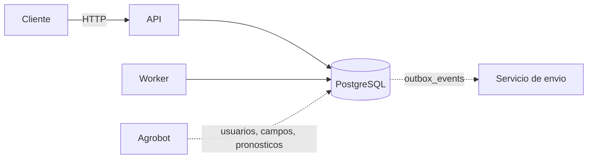

# Agroclimate - FieldData Challenge

API de alertas climaticas. Consume usuarios, campos y pronosticos de Agrobot y
administra alertas y notificaciones: se define un umbral para un evento de un
campo, un worker evalua los pronosticos y notifica a los usuarios del campo.

Las notificaciones se exponen de dos formas:

- **API REST**, para consultarlas y marcarlas como leidas.
- **Outbox** (`outbox_events`), para que otro servicio (por ejemplo, el que
  envia WhatsApp) las consuma leyendo esa tabla.

Hecho con Python 3.14, FastAPI, PostgreSQL, SQLAlchemy y Alembic.

## Arquitectura



Hay dos procesos: la **API**, que atiende los pedidos HTTP para crear alertas y leer notificaciones, y el **worker**,
que cada una hora evalua las alertas y genera, de ser necesario, las notificaciones.
Para hablarse entre si los dos leen y escriben la misma base de datos.

En la base de datos tenemos las tablas:

- `users`, `fields` y `weather_forecasts` que son de Agrobot. Este servicio solo las lee.
- `alerts`, `notifications` y `outbox_events` son de este servicio y se crean
  con las migraciones de Alembic.

En realidad a esas tablas le mockeamos datos, pero en produccion son externas y este servicio no las crea ni modifica.

## Primeros pasos

Requisitos: Docker, Docker Compose y [uv](https://docs.astral.sh/uv/getting-started/installation/).

```bash
cp .env.example .env
uv sync --locked
make start
```

`make start` levanta PostgreSQL, aplica las migraciones y levanta la API y el
worker. La documentacion interactiva (Swagger) queda en
`http://localhost:8000/docs`.

### Ver el flujo completo

```bash
make demo
```

Carga datos de ejemplo, crea una alerta por la API, corre el worker y muestra
las notificaciones y los eventos de outbox que se generaron. Despues corre el
worker de nuevo para mostrar que no se duplica nada, es idempotente.

### Probarlo por tu cuenta

```bash
make sample
```

Muestra un usuario, uno de sus campos y los pronosticos de ese campo, junto con
un `curl` para crear una alerta. Con eso podes:

1. Crear la alerta con el `curl`.
2. Correr una evaluacion con `make worker-once`.
3. Ver las notificaciones en `GET /v1/notifications` desde Swagger, con el
   mismo usuario en el header `X-User-Id`.

## API

No hay login: el usuario se indica con el header `X-User-Id`, y tiene que
existir en `users`.

| Metodo | URL | Que hace |
| --- | --- | --- |
| `POST` | `/v1/alerts` | Crea una alerta para un campo del usuario. |
| `GET` | `/v1/alerts` | Lista las alertas de los campos del usuario. |
| `GET` | `/v1/alerts/{id}` | Devuelve una alerta. |
| `PATCH` | `/v1/alerts/{id}` | Cambia el umbral o la activa/desactiva. |
| `DELETE` | `/v1/alerts/{id}` | Borra una alerta. |
| `GET` | `/v1/notifications` | Lista las notificaciones del usuario. |
| `POST` | `/v1/notifications/read` | Marca notificaciones como leidas. |

Una alerta se crea indicando el campo, el evento y el umbral:

```json
{
  "field_id": "9db92bf7-a281-4309-b204-a816f0647108",
  "event_type": "frost",
  "threshold": 80
}
```

El evento puede ser `frost` (helada), `rain` (lluvia), `hail` (granizo),
`strong_wind` (viento fuerte) o `heat` (calor). El umbral es la probabilidad
minima, en porcentaje, a partir de la cual se avisa, que es un numero de 1 a 100.

Errores posibles:

| Codigo | Cuando |
| --- | --- |
| `401` | Falta `X-User-Id` o el usuario no existe. |
| `404` | El campo o la alerta no existe, o el usuario no tiene acceso. |
| `409` | Ya hay una alerta para ese campo y evento. |
| `422` | Algun dato del pedido es invalido. |

## Evaluacion

En cada ciclo, el worker:

1. Toma las alertas activas.
2. Busca los pronosticos de ese campo para el evento en cuestion desde hoy en adelante.
3. Por cada fecha cuya probabilidad alcanza el umbral, crea una notificacion
   para cada usuario del campo, salvo que esa fecha ya se haya avisado.
4. Por cada notificacion nueva, deja un evento en el outbox.

Por ejemplo: un campo con 3 usuarios tiene una alerta de helada al 70%. El
pronostico dice 80% para el jueves y 50% para el viernes. El worker crea 3
notificaciones para el jueves, una por usuario, y ninguna para el viernes. En
las corridas siguientes no vuelve a avisar para el jueves.

## Outbox

El envio real (WhatsApp, app, email) no esta en el alcance del take home creo.
Para que dejar lista la integracion con otro servicio, cada notificacion nueva deja una fila en
`outbox_events` con `event_type = notification.created` y un `payload` JSON con
el usuario, el campo, el evento, la fecha, la probabilidad y el umbral.

La notificacion y su evento se guardan juntos: si falla uno, no se guarda
ninguno.

El servicio que consume el outbox deberia leer los eventos pendientes y los marca como
publicados:

```sql
select id, payload
from outbox_events
where published_at is null
order by created_at, id
limit 100
for update skip locked;

-- despues de enviarlos
update outbox_events set published_at = now() where id = any(:ids);
```

## Decisiones

### Producto

- **Umbral.** Todos los eventos se comparan como `probability >= threshold`.
  No hay alertas por temperatura ni por velocidad de viento. Tendria sentido para mi que una alerta sea por, por ejemplo, "alta probabilidad de viento fuerte de >40km/h", pero para mi no esta en el alcance del take home, se podria agregar a futuro.
- **Alerta por campo.** Decidi que el umbral es una decision sobre el campo y el
  evento en cuestion, no que cada usuario tenga su propio umbral. Hay una sola alerta por `(campo, evento)`: todos
  los usuarios del campo la ven, la editan y reciben sus avisos. Si se intenta
  crear otra, responde `409` avisando que ya existe. Esta forma tambien permite que el worker haga una sola evaluacion por alerta, en vez de una por usuario, es mas facil de escalar y para mi una decision de producto razonable.
- **Ventana.** Se evaluan todos los pronosticos futuros disponibles, incluido
  hoy en la zona horaria del campo. Es decir, que si tenemos forecast del tiempo para los proximos 7 dias, el worker evalua los 7 dias. No hay un limite de dias configurable por alerta, aunque podria agregarse a futuro.
- **Una notificacion por fecha.** Lluvia el viernes y lluvia el sabado son dos
  notificaciones. Una fecha ya avisada no se vuelve a avisar, aunque el umbral
  siga superado o el pronostico cambie.
- **Bajas de probabilidad.** No se avisa cuando el riesgo baja. Para avisar cuando baja, habria que guardar el estado anterior de cada alerta y comparar con el nuevo, podria agregarse a futuro.
- **Historial.** La notificacion guarda la probabilidad y el umbral del
  momento.
- **Acceso.** Se usa `fields.related_users` en cada evaluacion: quien deja de
  estar en el campo deja de recibir avisos nuevos.

### Tecnicas

- **Que es notificar.** Guardar la notificacion, exponerla por API y dejar un
  evento en el outbox. El envio por WhatsApp u otro canal queda fuera como dice la consigna.
- **Campo y clima.** El pronostico se vincula al campo por `field_id`. El campo
  tiene latitud, longitud y zona horaria.
- **Zona horaria.** El "hoy" es el dia local del campo (`fields.timezone`), no
  el del servidor o UTC, para no errarle en el dia del pronostico.
- **Worker aparte.** Corre en un proceso separado de la API, con intervalo
  configurable. `make worker-once` corre un solo ciclo, util para dispararlo
  desde un cron o despues de cargar pronosticos si se tuviera un orquestrador.
- **Varias instancias.** De necesitarse, se pueden correr varios workers a la vez.
  Se rechaza notificaciones repetidas (`UNIQUE` + `ON CONFLICT DO NOTHING`), asi
  que no hacen falta locks.
- **Auth y datos externos.** `X-User-Id` simula la identidad. Las tablas de
  Agrobot se crean localmente solo para desarrollo y tests.

## Configuracion

Las variables se leen desde `.env` y `.env.example` tiene todas con valores para
desarrollo. Estas en particular son las mas importantes para el comportamiento del worker:

| Variable | Default | Uso |
| --- | --- | --- |
| `EVALUATION_INTERVAL_SECONDS` | `3600` | Cada cuanto evalua el worker. |
| `EVALUATION_TIMEOUT_SECONDS` | `30` | Tiempo maximo de cada evaluacion. |

## Tests y calidad

```bash
make check       # ruff format, ruff lint y mypy
make test        # pytest unitarios e integracion
make coverage    # falla por debajo de 90%
```

Los tests de integracion crean una db `agroclimate_test`, aplican las migraciones y
envuelven cada test en una transaccion con rollback. No corren si PostgreSQL no es local.

## Estructura

```text
src/agroclimate/
├── api/                  # health, dependencias, alerts y notifications
├── core/                 # settings y observabilidad
├── db/                   # modelos, sesion, settings y migraciones
├── services/evaluation/  # evaluacion de alertas y outbox
├── main.py               # app factory
└── worker.py             # loop del worker

scripts/
├── create_external_tables.py  # tablas externas locales
├── demo.py                    # flujo completo para probarlo
├── sample.py                  # usuario, campo y pronosticos de ejemplo
└── seed_db.py                 # datos demo locales

tests/                    # unitarios e integracion
```

## Trabajo futuro

- Integrar la autenticacion real de Agrobot.
- Ventana de dias configurable por alerta.
- Avisar cuando el riesgo baja del umbral.
- Alertas no solo por probabilidad, sino por la magnitud del evento (temperatura, velocidad de viento, etc).
- Un servicio que consuma los eventos del outbox y envie whatsApp, email, etc.
